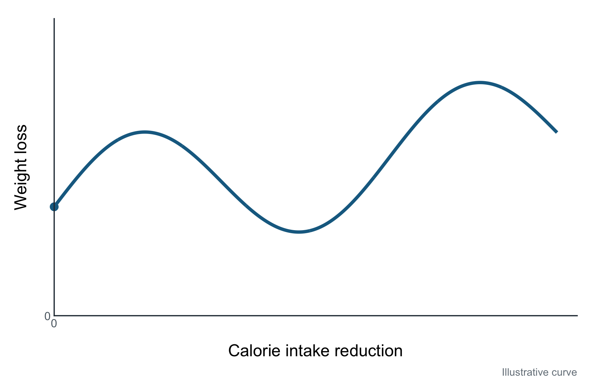
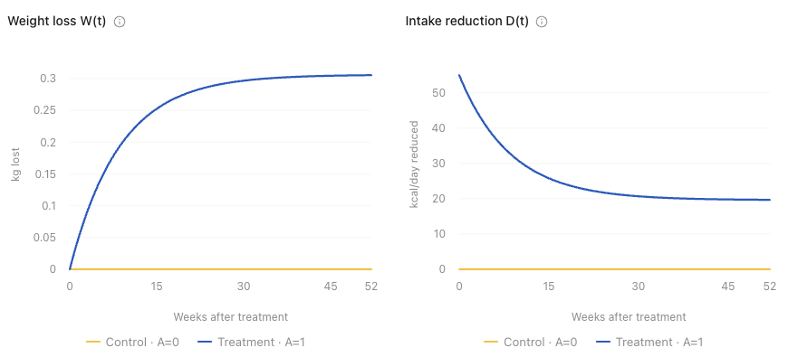
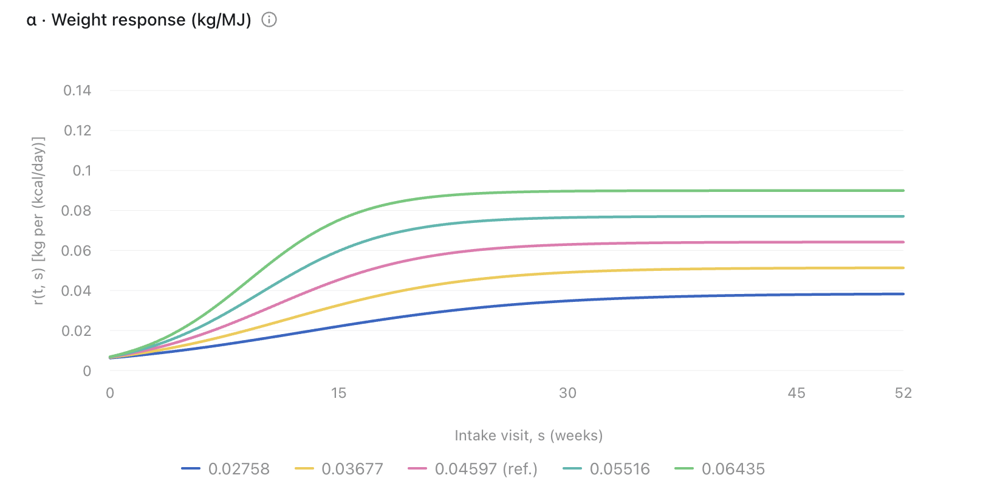
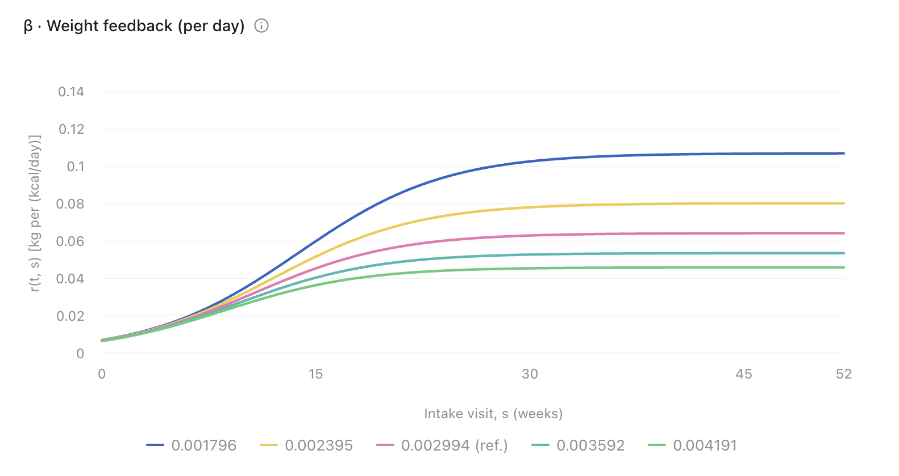
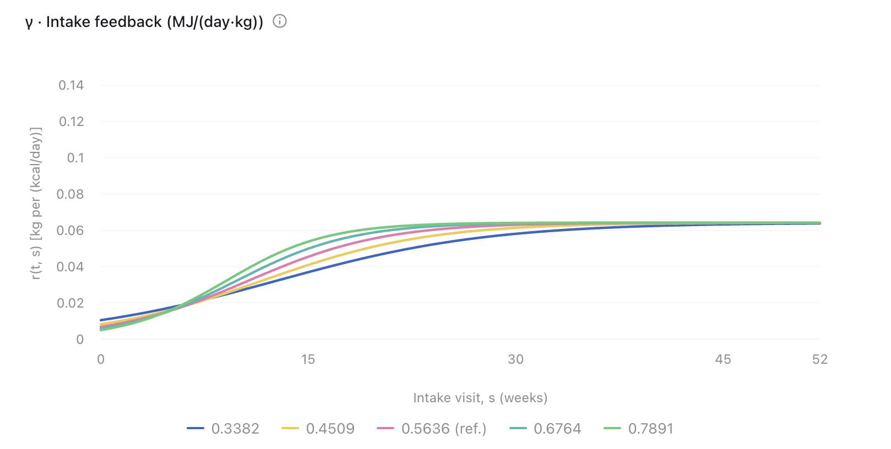

# Motivation: Biomarkers and endpoints in randomized clinical trials

One way to think about drug development is as a sequence of questions:

1. What disease outcome do we want to improve, and which endpoint will measure that improvement?
2. Which candidate biomarkers are strongly associated with the endpoint?
3. How do the biomarkers and endpoint interact?
4. Can a drug influence the endpoint by acting on one or more of these biomarkers?
5. Does the drug improve outcomes over time in a randomized clinical trial?

For illustration, consider a treatment intended to reduce cardiovascular risk through weight loss in patients with high body fat. In this example, weight loss is the endpoint, and calorie intake is a candidate biomarker and treatment target. Understanding their biological relationship can help motivate a treatment that acts on calorie intake.

The form of that relationship matters. Suppose the relationship between intake reduction and weight loss were nonmonotonic, as in the illustration below. Choosing how much to change the biomarker would then be less straightforward. A monotonic relationship would make the biomarker easier to interpret as a treatment target.

{#fig-weight-loss width=80%}

Even a strong monotonic association does not eliminate the risk of drug-development failure. Two statistical questions remain:

1. How should we quantify uncertainty in a stochastic model of the biomarker and endpoint?
2. How can biomarker measurements improve our analysis of the treatment effect on the endpoint?

The amount of available data affects both questions. With abundant data, we have more scope to assess predictive performance, for example through cross-validation, and may already be able to estimate the endpoint effect precisely. With a small patient sample, model misspecification is harder to assess, and the endpoint-effect estimate may be imprecise. Biomarker measurements could provide additional information.

This post focuses on the second question. I leave model assessment and uncertainty quantification for future work. Throughout, I use a longitudinal study of weight loss and calorie intake reduction as the running example.

# Defining causal effects

Assume a binary treatment administered at time $0+$. In our example, the treatment is designed to act directly on the biomarker, intake reduction. Using the potential-outcome framework, define the biomarker outcomes as follows:
$$
\begin{align}
\begin{cases}
D^1_i(t): \text{ intake reduction of patient }i \text{ at time }t\text{ if treated}\\
D^0_i(t): \text{ intake reduction of patient }i \text{ at time }t\text{ if control}
\end{cases}
\end{align}
$$
Similarly, define the potential outcomes for the endpoint, weight loss:
$$
\begin{align}
\begin{cases}
W^1_i(t): \text{ weight loss of patient }i \text{ at time }t\text{ if treated}\\
W^0_i(t): \text{ weight loss of patient }i \text{ at time }t\text{ if control}
\end{cases}
\end{align}
$$

Assume the full observed dataset $\{Z_i\}_{i\in [n]} = \{A_i,W^1_i(t_1), W^0_i(t_1), D^1_i(t_1), D^0_i(t_1), \dots, W^1_i(T), W^0_i(T), D^1_i(T), D^0_i(T)\}_{i\in [n]}$ is an i.i.d. sample from the counterfactual distribution $(\mathbb{P}^*)^{\otimes n}$. For the realized sample, my target estimand is the sample average causal effect on the endpoint at time $t$:
$$
\tau(t) = \frac{1}{n}\sum^n_{i=1}\left\{W^1_i(t) - W^0_i(t)\right\}
$$
The corresponding sample average causal effect on the biomarker is
$$
\psi(t) = \frac{1}{n}\sum_{i=1}^n\left\{D^1_i(t) - D^0_i(t)\right\}
$$

Under consistency and balanced randomization, we estimate these sample effects using the observed treatment and control groups:
$$
\begin{aligned}
\hat\tau(t) &= \frac{2}{n}\sum_{i:A_i=1}W_i(t)-\frac{2}{n}\sum_{i:A_i=0}W_i(t),\\
\hat\psi(t) &= \frac{2}{n}\sum_{i:A_i=1}D_i(t)-\frac{2}{n}\sum_{i:A_i=0}D_i(t).
\end{aligned}
$$
Conditional on the sample's potential outcomes, these estimators are unbiased over the randomized treatment assignment. Throughout, $n$ denotes the total sample size, with $n/2$ patients in each arm.

# A joint stochastic model

There are many ways to model the joint trajectories of the biomarker and endpoint. Assessing how well a model represents real-world data is an equally important task, but it is beyond the scope of this post. Here, I start with an idealized model to explore when biomarker measurements might improve estimation.

Following Hall et al.[^hall1], I model weight loss, measured in kilograms, as a function of intake reduction. For $a=0,1$,
$$
\frac{d}{dt}W^a_i(t) = \alpha_i D^a_i(t) - \beta_i W^a_i(t)
$$
where $\alpha_i>0$ is the intake-feedback parameter and $\beta_i>0$ is the body-fat parameter. The model reflects two features:

- Body weight adjusts gradually after a sustained change in calorie intake.
- Starting body fat affects both the amount of weight lost and the time required. In this model, patients with more body fat have smaller values of $\beta_i$.

Drawing on related work[^hall2][^hall3], I model calorie intake reduction, measured in kcal/day, as follows. For $a=0,1$,
$$
D^a_i(t) = ap_i - \gamma_i W^a_i(t)
$$
where $p_i\in [0,1]$ represents the initial treatment response and $\gamma_i>0$ is the weight-loss feedback parameter. The biomarker responds to treatment initially and then changes through feedback from weight loss.

To simplify the setting further, assume that patients in the control condition have no change in weight or calorie intake:
$$
W_i^0(t) = D^0_i(t) = 0 \qquad \text{ for all }i
$$
For the deterministic trajectories, solving the differential equation with $W_i^a(0)=0$ gives, for $a=1$,
$$
\begin{align*}
W^1_i(t) = \frac{\alpha_i p_i}{\beta_i + \alpha_i \gamma_i}\left(1-e^{-(\beta_i + \alpha_i\gamma_i)t}\right)\\
D^1_i(t) = \frac{p_i}{\beta_i + \alpha_i \gamma_i}\left(\beta_i + \alpha_i \gamma_i e^{-(\beta_i + \alpha_i\gamma_i)t}\right)
\end{align*}
$$
Finally, introduce mean-zero Gaussian noise $(\varepsilon_i(t), \delta_i(t))\perp\!\!\!\perp A_i$ to represent variability across patients. Assume common parameters $\alpha_i=\alpha$, $\beta_i=\beta$, $\gamma_i=\gamma$, and $p_i=p$ for all patients:
$$
\begin{align*}
W^a_i(t) = \frac{\alpha p}{\beta + \alpha \gamma}\left(1-e^{-(\beta + \alpha\gamma)t}\right) a + \varepsilon_i(t)\\
D^a_i(t) = \frac{p}{\beta + \alpha \gamma}\left(\beta + \alpha \gamma e^{-(\beta + \alpha\gamma)t}\right) a + \delta_i(t)
\end{align*}
$$
The same $\varepsilon_i(t)$ appears in both treatment potential outcomes for patient $i$, and likewise for $\delta_i(t)$. This is intentional: the noise cancels in each within-patient causal contrast. Together with the common parameters, this gives deterministic causal effects and an exact relationship between the two sample effects. Estimators based on the observed treatment and control groups remain variable because the groups contain different patients. The differential equations describe the deterministic components of these noisy outcomes.

The deterministic trajectories illustrate the average response under treatment and control:

{#fig-det-plot width=80%}

The parameters affect the trajectories in different ways:

- Larger $\alpha$ produces more pronounced curvature, while smaller $\alpha$ produces less.
- Larger $\beta$ produces more pronounced curvature in $W(t)$ and an earlier plateau in $D(t)$. Smaller $\beta$ has the opposite effect.
- Larger $\gamma$ produces more pronounced curvature, while smaller $\gamma$ produces less.
- Larger $p$ widens the treatment-control gaps, while smaller $p$ narrows them.

# The relationship between the causal effects

Under this model, the sample endpoint and biomarker effects are proportional, with a ratio that does not depend on the initial response $p$. For any $s\leq t$,
$$
\tau(t) = \underbrace{\frac{\alpha(1-e^{-(\beta+\alpha\gamma)t})}{\beta + \alpha\gamma e^{-(\beta+\alpha\gamma)s}}}_{=:r(t,s)}~\psi(s)
$$
This relationship suggests using an estimate of the biomarker effect at time $s$ to draw conclusions about the endpoint effect at time $t$. **When would this approach be more efficient than estimating the endpoint effect directly?**

To explore this question, first consider the ratio function $s\mapsto r(t,s)$ for a fixed endpoint time $t$. The following plots show $r(52,s)$ as one parameter varies while the other two remain fixed. For example, the first plot shows $s\mapsto r(52,s; \alpha, \beta_{\text{ref}}, \gamma_{\text{ref}})$, using reference values $(\alpha_{\text{ref}},\beta_{\text{ref}},\gamma_{\text{ref}})=(0.045966,0.002994,0.563631)$.[^GPT]

{#fig-alpha-ratio width=80%}

{#fig-beta-ratio width=80%}

{#fig-gamma-ratio width=80%}

Statistical usefulness can mean several things, including low bias or robustness to model misspecification. Here, I focus on efficiency, comparing the variance of a biomarker-based endpoint-effect estimate with that of a direct endpoint-effect estimate.

I consider two scenarios:

1. The parameters $\alpha,\beta,\gamma$, and therefore the ratio $r(t,s)$, are known.
2. The parameters are unknown, so $r(t,s)$ must be estimated.

For the remaining analysis, consider a hypothetical experiment in which the full counterfactual dataset is available. The data-generating process has the following features:

- A random sample of $\{Z_i\}_{i=1}^n$, with $n=200$ and measurements at $t = (1, 2, 4, 8, 12, 24, 36, 52)$ weeks.
- Gaussian noise independent across time: $\delta_i(t) \sim N(0, \sigma^2_\delta)$ and $\varepsilon_i(t) \sim N(0, \sigma^2_\varepsilon)$.
- Balanced treatment assignment: $\sum_i A_i = 100$ and $\sum_i (1-A_i) = 100$.

## Scenario 1: A known ratio

When the ratio is known, Gaussian noise is the only source of randomness in this simplified model. Whether the biomarker-based estimate is more precise depends on the estimator and the variability of the measurements. For difference-in-means estimators in the balanced trial, averaging over generated samples and randomized assignments gives, for $s\leq t$,
$$
\begin{align*}
\text{var}(\hat\tau(t)) &= \frac{2}{n}\left\{\text{var}(W^1_i(t)) + \text{var}(W^0_i(t))\right\}=\frac{4~\sigma^2_\varepsilon}{n}\\
\text{var}(r(t,s)\hat \psi(s)) &= r(t,s)^2 ~\frac{4~\sigma^2_\delta}{n}
\end{align*}
$$
Thus,
$$
r(t,s)^2 \text{var}(\hat\psi(s))< \text{var}(\hat\tau(t))~ \iff  ~r(t,s)^2~ \sigma^2_\delta < \sigma^2_\varepsilon
\tag{1}
$$
This inequality compares biomarker variability, after scaling by the squared ratio, with endpoint variability. For the estimators considered here, the biomarker-based estimate is more efficient when the biomarker at some time $s^*\leq t$ has sufficiently low variability after conversion to the endpoint scale.

For a numerical example, let $t=52$, $\sigma^2_\delta = 35^2$, and $\sigma^2_\varepsilon=0.3^2$, with intake reduction measured in kcal/day and weight loss in kg. Using $(\alpha_{\text{ref}},\beta_{\text{ref}},\gamma_{\text{ref}})=(0.045966,0.002994,0.563631)$ gives $r(52,1)^2 = 0.00006338$ and $r(52, 4)^2 = 0.00017524$.[^GPT] The scaled biomarker variances are approximately $0.07764$ at week 1 and $0.21467$ at week 4, compared with the endpoint variance $0.09$. Thus, $r(52,1)\hat\psi(1)$ is more efficient than $\hat\tau(52)$, whereas $r(52,4)\hat\psi(4)$ is not.

## Scenario 2: An unknown ratio

When $r(t,s)$ is unknown, it must also be estimated. A simple approach is to use historical estimates of the two causal effects. Suppose a historical training sample includes biomarker measurements at time $s$ and endpoint outcomes through time $t$. Assume that the same causal-effect ratio applies to the training and analysis samples, and denote the training estimates by $\hat\tau_{train}(t)$ and $\hat\psi_{train}(s)$. We can then estimate the ratio as
$$
\hat r(t,s) = \frac{\hat\tau_{train}(t)}{\hat\psi_{train}(s)}
$$

We can derive an analogous precision threshold that accounts for uncertainty in the estimated ratio. Assume that $\hat r(t,s)$ and $\hat\psi(s)$ are sufficiently well behaved for a first-order variance approximation, with higher-order terms negligible. Also assume $\psi(s)\ne 0$ and a stable training-sample denominator. Then,
$$
\text{var}(\hat r(t,s) \hat \psi(s)) \approx r(t,s)^2 ~\text{var}(\hat \psi(s)) + \underbrace{\psi(s)^2 ~\text{var}(\hat r(t,s)) + 2~r(t,s)\psi(s)~\text{cov}(\hat r(t,s), \hat\psi(s))}_{=\text{additional variability}}
$$
This expression follows from a first-order expansion of $\hat r\hat\psi-r\psi$. One way to control the additional variability is to estimate the ratio using a separate sample. First, if $\hat\psi_{train}$ is consistent,
$$
\begin{align*}
\hat r - r &= \frac{\hat \tau_{train}(t) - r\hat\psi_{train}(s)}{\hat\psi_{train}(s)}\\
&=\frac{\hat \tau_{train}(t) - r\hat\psi_{train}(s)}{\psi(s)}(1 + o_{\mathbb{P}}(1))
\end{align*}
$$
If $\hat\tau_{train}(t)$ and $\hat\psi_{train}(s)$ are estimated from a training sample of size $n_{train}$ that is independent of the sample used to estimate $\hat\psi(s)$, then
$$
\text{cov}(\hat r(t,s), \hat\psi(s)) = 0
$$
Therefore,
$$
\text{var}(\hat r(t,s) \hat \psi(s)) \approx r(t,s)^2 ~\text{var}(\hat \psi(s)) + \underbrace{\text{var}(\hat \tau_{train}(t) - r\hat\psi_{train}(s))}_{=\text{additional variability}}
$$
For the difference-in-means estimators considered above, additionally assume that the endpoint and biomarker noises are uncorrelated within the training sample. With balanced assignment in both samples and the same noise variances, the first-order precision threshold becomes
$$
\left(1+\frac{n}{n_{train}}\right)r(t,s)^2~ \sigma^2_\delta < \left(1- \frac{n}{n_{train}}\right)\sigma^2_\varepsilon
$$
Compared with inequality (1), this condition depends on the relative sizes of the training and analysis samples. In particular, when $n_{train}\leq n$, the displayed condition cannot be satisfied, so the first-order comparison offers no efficiency gain under these assumptions.

# Conclusion

This exercise uses a joint stochastic model of biomarker and endpoint potential outcomes to explore when a biomarker-based estimate can be more precise than a direct estimate of the endpoint effect. I consider two idealized settings: one in which the relationship between the causal effects is known, and another in which it must be estimated.

The key takeaways, together with the assumptions behind them, are:

1. **Precision gains depend on scaled variability.** With a known ratio, the biomarker-based estimate improves on the direct difference-in-means estimate when $r(t,s)^2\sigma_\delta^2<\sigma_\varepsilon^2$.
2. **The exact relationship is a modeling assumption.** Common parameters and noise shared across each patient's treatment potential outcomes make the sample causal effects deterministic and proportional. The efficiency comparison relies on this structure, together with consistency and randomized treatment assignment.
3. **Estimating the ratio adds uncertainty.** The first-order comparison assumes well-behaved estimators and a ratio that applies to both samples. Independent training and analysis samples eliminate $\operatorname{cov}(\hat r,\hat\psi)$, but do not eliminate uncertainty in $\hat r$. The displayed sample-size threshold also assumes uncorrelated endpoint and biomarker noises within the training sample.

[^hall1]: Hall, Kevin D., et al. "Quantification of the effect of energy imbalance on bodyweight." The Lancet 378.9793 (2011): 826-837.
[^hall2]: Polidori, David, et al. "How strongly does appetite counter weight loss? Quantification of the feedback control of human energy intake." Obesity 24.11 (2016): 2289-2295.
[^hall3]: Hall, Kevin D., Arjun Sanghvi, and Britta Göbel. "Proportional feedback control of energy intake during obesity pharmacotherapy." Obesity 25.12 (2017): 2088-2091.
[^GPT]: The reference parameter values were suggested by Astra 6.2 after reviewing Kevin Hall's work.
